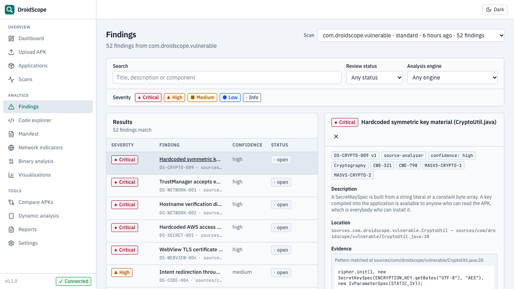
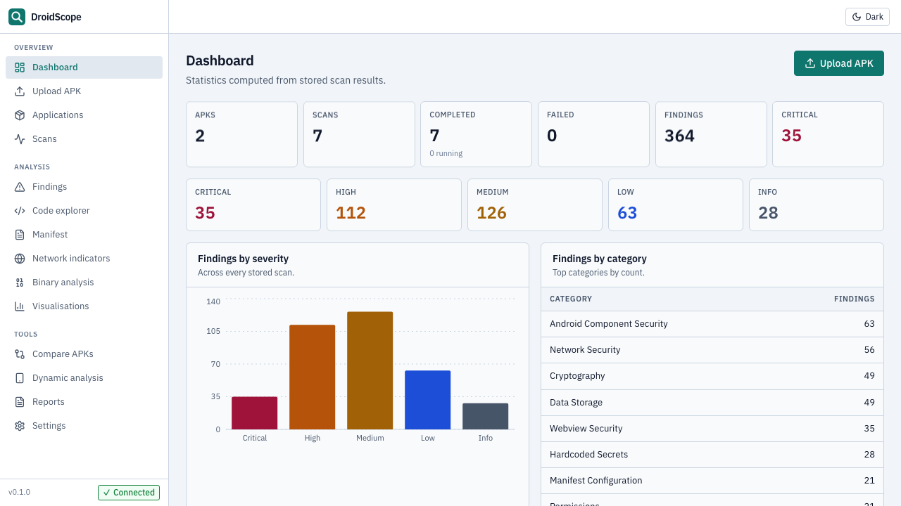
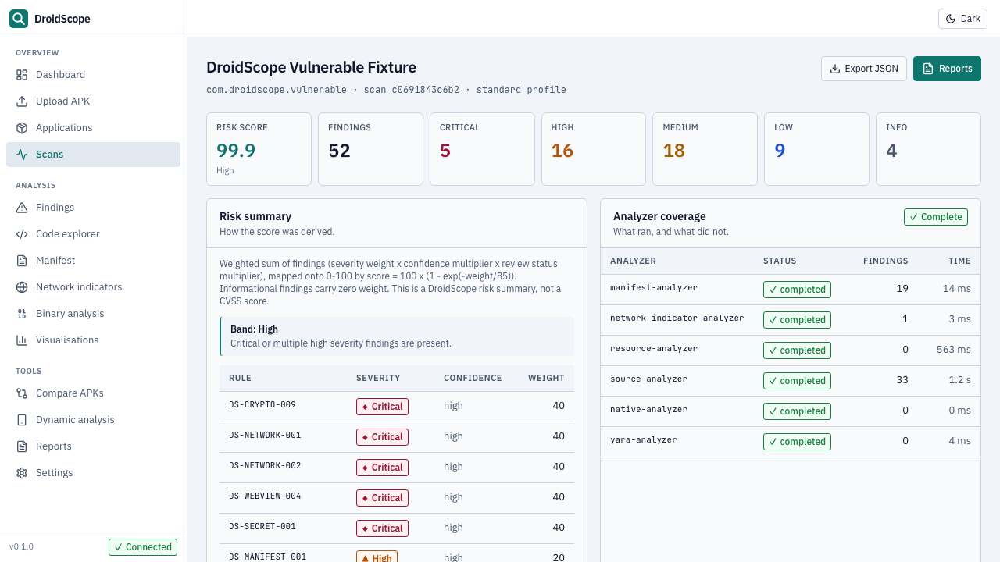
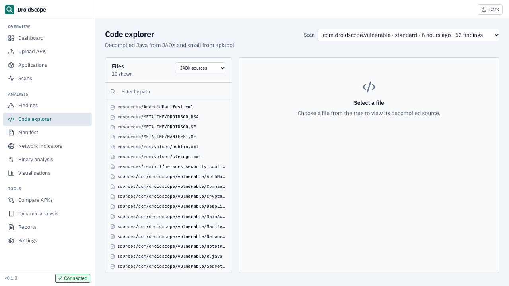
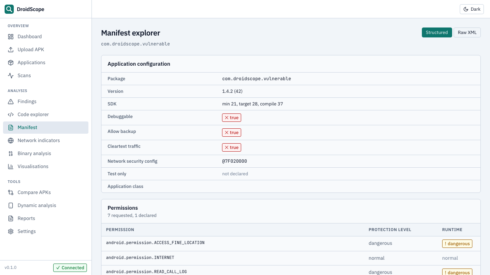
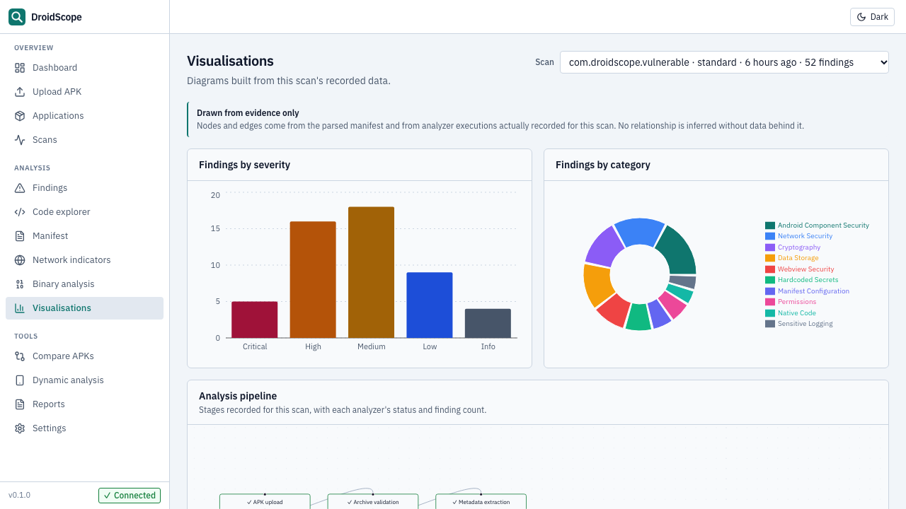
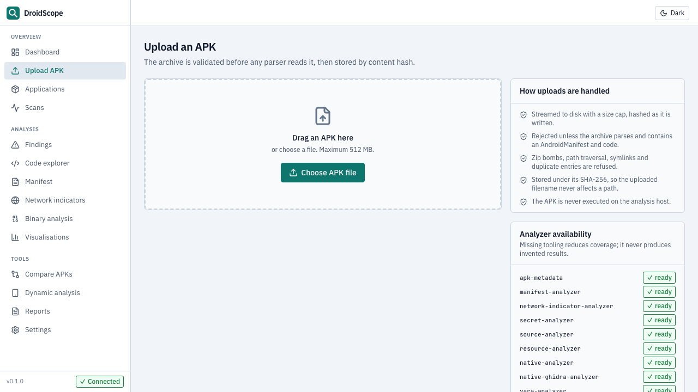
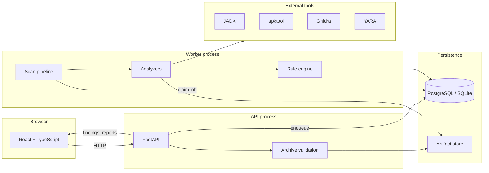

# DroidScope

**Analyze Deeper. Detect Smarter. Secure Android.**

DroidScope is an open-source Android application security analysis platform. It
takes an APK, validates it, decompiles it, evaluates it against versioned
detection rules, and produces findings that carry their own evidence — along
with an explicit statement of what the analysis did *not* cover.

> **Design principle.** A scanner is only useful if you can trust what it says.
> DroidScope reports what it observed, shows the evidence, and names its
> limitations. It never fabricates a finding, never claims an analyzer ran when
> it did not, and never reports a clean scan as proof that an application is
> secure.



---

## Contents

- [What it does](#what-it-does)
- [Screenshots](#screenshots)
- [Quick start](#quick-start)
- [Architecture](#architecture)
- [Detection rules](#detection-rules)
- [Analysis profiles](#analysis-profiles)
- [Command line](#command-line)
- [Supported environments](#supported-environments)
- [Known limitations](#known-limitations)
- [Development](#development)
- [Security](#security)
- [Contributing](#contributing)
- [License](#license)

---

## What it does

### Static analysis

| Capability | Detail |
|---|---|
| **Archive validation** | Rejects zip bombs, path traversal, symlink entries, unsupported compression and non-APK archives *before* any parser reads the file |
| **Metadata extraction** | Package identity, SDK levels, components, permissions, signing certificates, DEX entries, native libraries, multidex |
| **Manifest analysis** | 14 structural rules that weigh component kind, target SDK and permission protection level before reporting |
| **Source analysis** | JADX decompilation feeding 37 declarative pattern rules with required and excluded context |
| **Secret detection** | Provider-specific formats plus entropy analysis; values are masked and fingerprinted, never stored in plaintext |
| **Network indicators** | URLs, domains and addresses classified by routing scope. Extracted destinations are never contacted |
| **Native binaries** | ELF architecture, symbols, dependencies and hardening flags, with an optional Ghidra adapter |
| **YARA** | Validated rule set with resource limits, reporting indicators rather than family attribution |
| **APK comparison** | Permission, component, signing and finding diffs correlated by fingerprint rather than line number |

### Reporting

PDF, HTML, JSON and SARIF 2.1.0, all rendered from one canonical document so
formats cannot drift. Every report states the scan id, the APK's SHA-256, the
tool versions that ran, the analyzers that did not complete, and why.

### Dynamic analysis (opt-in)

Device discovery over ADB and read-only Frida instrumentation for file, crypto,
network and process APIs. DroidScope deliberately ships **no** module that
bypasses certificate validation, root detection or biometric checks.

---

## Screenshots

All screenshots are captured from the running application analysing the
[deliberately vulnerable fixture](tests/fixtures/vulnerable-app) included in
this repository. They are regenerated with `make screenshots`.

| | |
|---|---|
|  **Dashboard** — counts computed from stored results |  **Scan detail** — risk summary and analyzer coverage |
|  **Code explorer** — decompiled sources in Monaco |  **Manifest explorer** — structured component view |
|  **Visualisations** — pipeline and component graphs |  **Upload** — light theme |

---

## Quick start

### Requirements

- Python 3.12+ and [uv](https://docs.astral.sh/uv/)
- Node.js 20+
- A JRE 17+ (JADX and apktool are JVM tools)

Everything else is optional. `droidscope doctor` reports what is present and
what each missing tool would enable.

### Install and run

```bash
git clone https://github.com/CodeWithLakxsh/DroidScope.git
cd droidscope

make setup          # backend venv + frontend dependencies
make doctor         # check which analysis tools are available
make dev            # API on :8000, worker, UI on :5173
```

Open <http://localhost:5173> and upload an APK.

### Analyse without a server

```bash
# The CLI runs the whole pipeline in-process; no API or worker needed.
droidscope analyze app.apk --profile standard
droidscope analyze app.apk --profile full --report pdf -o report.pdf

# Useful in CI: exit 1 when a finding at or above the threshold is present.
droidscope analyze app.apk --fail-on high
```

### Docker

```bash
docker compose up --build        # UI at http://localhost:8080
```

PostgreSQL and Redis are not published to the host. The worker, which parses
untrusted input, runs with a read-only root filesystem, all Linux capabilities
dropped and `no-new-privileges`.

### Try it against the fixture

The repository contains two Android applications built from source — one
deliberately insecure, one the corrected counterpart:

```bash
make fixtures                                        # needs the Android SDK
droidscope analyze tests/fixtures/vulnerable-app.apk  # 52 findings
droidscope analyze tests/fixtures/secure-app.apk      # 3, all info or low
```

That contrast is the point: both applications call the same Android APIs. The
rules fire on the misuse, not on the keyword.

---

## Architecture



Decompilation is CPU and memory heavy, so it never happens inside an HTTP
request: the API enqueues a job and a separate worker process claims it. See
[docs/architecture/](docs/architecture/) for the full diagrams, including the
analysis pipeline, the job lifecycle and the data model.

### Repository layout

```
backend/app/
  analyzers/      apk, manifest, source, native, yara, network, dynamic
  detection/      rule contracts, registry, contexts, normalised findings
  services/       pipeline, scans, APKs, risk scoring, comparison
  reports/        document builder and PDF/HTML/JSON/SARIF renderers
  jobs/           durable queue and worker
  api/v1/         REST endpoints
  storage/        content-addressed artifact store
frontend/src/     React application (17 pages)
rules/            declarative detection rules (YAML) and YARA rules
tests/fixtures/   two Android apps built from source: vulnerable and secure
docs/             architecture, installation, analyzer and security docs
```

---

## Detection rules

**59 rules** across six engines. Structural rules are Python (they reason about
platform behaviour); pattern rules are declarative YAML in [`rules/`](rules/).

| Engine | Rules | Examples |
|---|---:|---|
| `source-analyzer` | 37 | weak crypto, WebView configuration, SQL injection, TLS validation, insecure storage |
| `manifest-analyzer` | 14 | exported components, debuggable, backup, cleartext, deep links, certificate quality |
| `native-analyzer` | 3 | missing RELRO/NX/PIE, unsafe imports, notable strings |
| `network-indicator-analyzer` | 2 | internal endpoints, raw IP endpoints |
| `secret-analyzer` | 2 | provider credential formats, entropy-based detection |
| `firebase-analyzer` | 1 | Firebase configuration observations |

Rules cite CWE identifiers and OWASP MASVS v2 controls, validated at load time —
a malformed identifier fails `droidscope rules validate` rather than silently
shipping.

### What makes a rule fire

Rules are written to avoid the failure mode that makes scanners unusable. For
example, `DS-MANIFEST-001` reports an exported component only when it is
genuinely reachable:

- a signature-level permission suppresses it (that is real access control);
- a `normal` permission does **not** (any app can hold one);
- a launcher activity is reported as informational, because being launchable is
  its job;
- an implied export on `targetSdk >= 31` lowers confidence, because the
  attribute is mandatory there and such a package would not install.

Writing your own: [docs/analyzers/writing-rules.md](docs/analyzers/writing-rules.md).

---

## Analysis profiles

| Profile | Includes | Typical duration |
|---|---|---|
| `quick` | Validation, metadata, permissions, manifest rules, network indicators | under a second on a small APK |
| `standard` | Quick, plus JADX decompilation, source/secret/Firebase rules, apktool decoding, native ELF inspection, YARA | a few seconds to minutes |
| `full` | Standard, plus Ghidra headless on the largest native library | minutes, depending on the binary |

Dynamic analysis is never part of a profile. It requires a separately
configured, explicitly authorised session, because it installs and runs the
application.

---

## Command line

```
droidscope doctor                        # what is installed, what it enables
droidscope analyze app.apk [--profile standard] [--json] [--fail-on high]
droidscope report <scan-id> --format pdf -o report.pdf
droidscope compare old.apk new.apk
droidscope rules list [--engine source-analyzer]
droidscope rules validate                # exits non-zero on a malformed rule
droidscope server [--port 8000]
droidscope worker
droidscope init-db
```

`doctor`, `analyze`, `report`, `compare` and `rules` work entirely locally.
`server` and `worker` start the long-running processes.

Exit codes: `0` success, `1` findings at or above `--fail-on`, `2` error,
`3` required tooling missing.

---

## Supported environments

| | Static analysis | Dynamic analysis |
|---|---|---|
| **macOS** (Intel and Apple silicon) | Supported | Emulator via Android Studio |
| **Linux** | Supported | Emulator needs KVM |
| **Windows 11** | Supported | Emulator needs WHPX/Hyper-V; use WSL2 for the backend |
| **Docker** | Supported | Not included — see [docs/installation/dynamic-analysis.md](docs/installation/dynamic-analysis.md) |

---

## Known limitations

Stated plainly, because a tool that hides these is worse than no tool.

- **Static analysis cannot see runtime behaviour.** Findings describe code and
  configuration as shipped, not what the application does when executed.
- **No findings is not a clean bill of health.** It means the rules that ran did
  not match. Every scan records which analyzers did not complete and why.
- **Obfuscated and packed applications reduce coverage.** Encrypted strings and
  reflection defeat pattern rules; DroidScope reports partial decompilation
  rather than hiding it.
- **Pattern rules carry false positives by design.** Each rule declares its own
  confidence and limitations, and findings can be marked false positive, which
  removes them from the risk score.
- **The risk score is a DroidScope summary, not CVSS.** It is a weighted,
  saturating function of severity, confidence and review status, documented in
  [docs/architecture/risk-scoring.md](docs/architecture/risk-scoring.md).
- **Firebase and other cloud configuration is observed, not tested.** Whether a
  database is readable depends on its security rules, which requires
  authorisation to check. DroidScope never contacts a project.
- **Frida instrumentation needs a cooperative device.** A third-party release
  build on a stock, non-rooted device cannot be instrumented without root, a
  debuggable build, or repackaging with frida-gadget. Sessions report this
  before they start rather than producing an empty timeline.
- **TLS payloads are not decrypted.** That needs an operator-configured proxy
  and a trust anchor on the test device, which DroidScope will not install for
  you.

Current implementation status, including what is tested and what is not, is
tracked in [docs/DEVELOPMENT_STATUS.md](docs/DEVELOPMENT_STATUS.md).

---

## Development

```bash
make check        # lint, type check, rule validation and tests
make test         # backend (pytest) and frontend (vitest)
make test-e2e     # Playwright against a running stack
make fixtures     # rebuild the fixture APKs from source
```

Full guide: [docs/development/](docs/development/).

---

## Security

DroidScope treats every uploaded APK as hostile input. Archive limits, safe
extraction, shell-free subprocess execution, content-addressed storage, secret
redaction and an unprivileged worker are described in
[docs/security/threat-model.md](docs/security/threat-model.md).

To report a vulnerability in DroidScope itself, see [SECURITY.md](SECURITY.md).

**Use it lawfully.** Analyse applications you own or have permission to test.
Dynamic analysis installs and runs an application on a device and requires
explicit per-session authorisation.

---

## Contributing

Contributions are welcome — new detection rules especially. Please read
[CONTRIBUTING.md](CONTRIBUTING.md); a new rule needs a test proving it fires on
a vulnerable input *and* a test proving it stays silent on the correct form.

---

## License

[Apache License 2.0](LICENSE). Third-party components are listed in [NOTICE](NOTICE).

Android is a trademark of Google LLC. DroidScope is not affiliated with,
endorsed by, or sponsored by Google.
