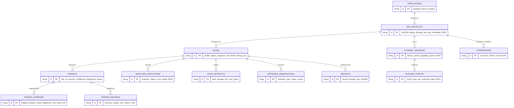

# Data model

19 tables. Large artifacts are never stored in rows: the database holds a
storage key and the artifact store resolves it.



Supporting tables without foreign keys: `jobs` (durable queue),
`detection_rule_states` (operator overrides), `capability_snapshots` (tool
availability at scan time), `audit_events`, `settings`.

## Notable choices

**Identifiers are 32-character hex UUIDs**, not autoincrementing integers. They
are safe to expose in a URL, they do not leak how many APKs an instance has
processed, and they generate without a round trip.

**`findings.fingerprint` excludes line numbers**, so a code shift does not make
an unchanged issue look new when diffing versions. See
[ADR-003](../ARCHITECTURE_DECISIONS.md).

**`finding_evidence.raw_value` is almost always NULL.** The detector handles
plaintext in memory; the column receives it only when a deployment explicitly
disables redaction. `snippet` holds the masked form and `value_fingerprint`
allows correlation without the secret.

**`analyzer_executions` records failures.** A scan where the source analyzer
was unavailable has a row saying so, with the reason. That row drives the
coverage section of the risk summary and the limitations section of every
report.

**Enum columns use `StrEnumType`**, a `TypeDecorator` that stores a `VARCHAR`
and returns the enum on read, so `row.severity.value` behaves identically on a
constructed and a loaded object. See [ADR-011](../ARCHITECTURE_DECISIONS.md).

**`scans.dedup_key`** is `sha256(apk_sha256 + profile + config)`, which is what
makes scan reuse safe: a different profile is a different key, so reuse can
never return a narrower scan than the one requested.

## Migrations

Alembic owns the production schema. `create_all()` exists for tests and for a
first local run.

```bash
make migrate                      # alembic upgrade head
make migration m="add something"  # autogenerate
cd backend && .venv/bin/alembic check   # detect drift from the models
```

Migrations render enum columns as plain `sa.String(length=n)` through a
`render_item` hook, so the schema history never imports application code.
