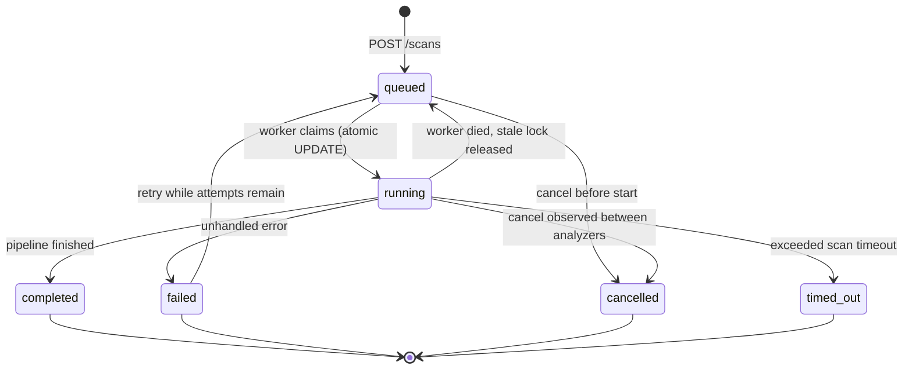

# Job lifecycle



## Claiming is atomic without locks

```sql
UPDATE jobs
   SET status = 'running', locked_by = :worker, attempts = attempts + 1
 WHERE id = :job_id AND status = 'queued';
```

Only one worker's `UPDATE` affects a row; the others see `rowcount = 0` and move
on to the next candidate. This behaves identically on SQLite and PostgreSQL and
needs no advisory locks or `SELECT ... FOR UPDATE`.

## Surviving a dead worker

A running job heartbeats every 30 seconds. A job whose `heartbeat_at` is older
than `STALE_LOCK_SECONDS` (900) is returned to `queued` by the next worker that
looks for work. A machine losing power therefore delays a scan rather than
losing it.

## Cancellation

Cancellation sets `cancel_requested` on the scan. The pipeline checks it
between analyzers, so a cancelled scan stops at the next boundary and keeps the
results it already produced, rather than being killed mid-write. A scan
cancelled before it starts moves straight to `cancelled`.

## Retries

`max_attempts` defaults to 1, because most scan failures are deterministic —
a malformed APK will fail identically on a retry. Retries use linear backoff
(`30s × attempts`) so a persistent failure cannot spin.

## Deduplication

Creating a scan whose `dedup_key` matches a completed scan returns the existing
one. A key matching a scan still queued or running returns that one instead of
creating a duplicate. Since the key includes the profile and configuration,
reuse can never return a scan narrower than the one requested.

Pass `reuse_existing: false` to force a fresh scan.
