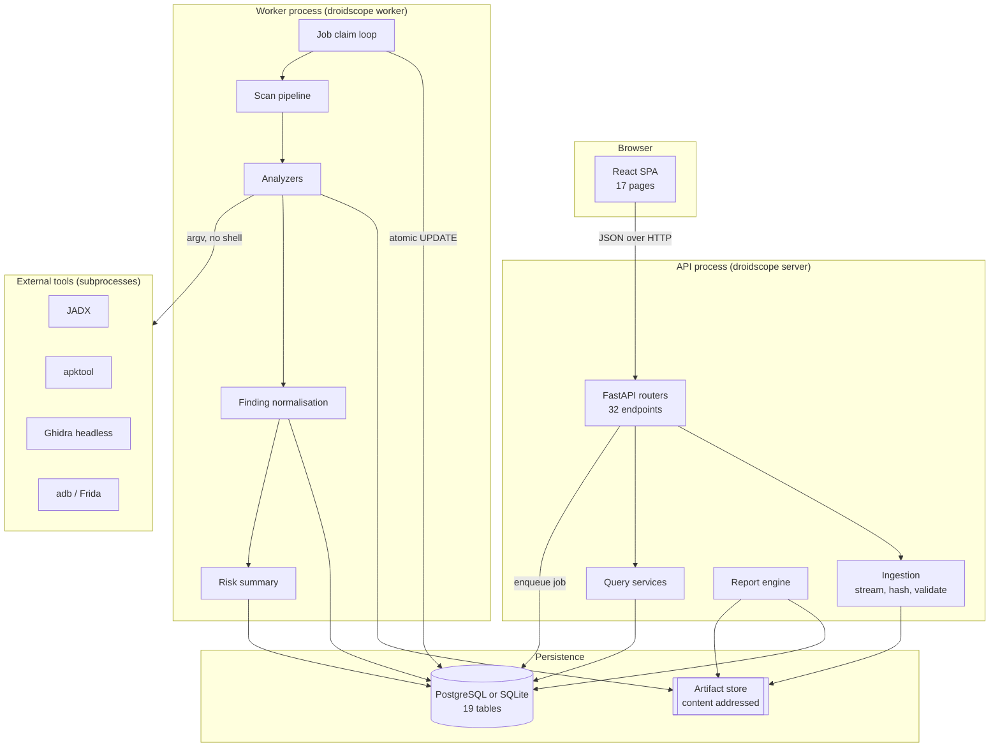
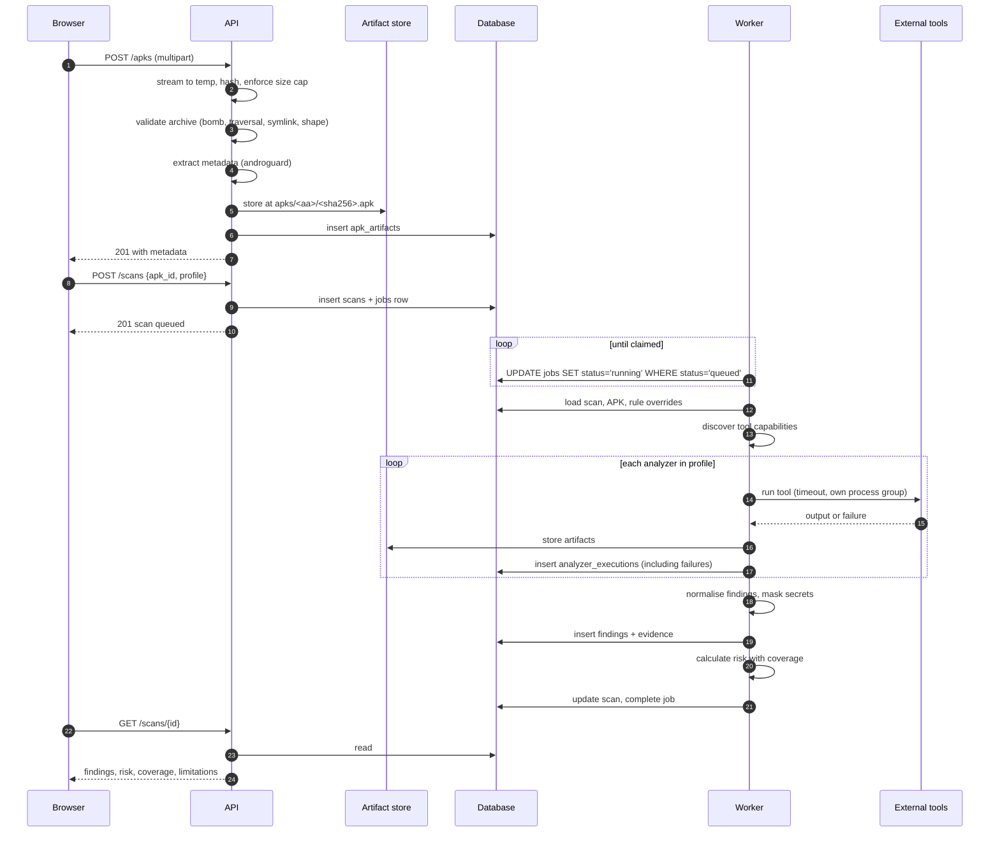

# Architecture overview

DroidScope is three processes over one database and one artifact store.

## Why the work is split

Decompiling an APK is CPU and memory heavy and can take minutes. Running it
inside an HTTP handler would tie up a request worker, make timeouts
meaningless, and let one large APK degrade the whole service. The API therefore
does only cheap, bounded work — validate, hash, store, enqueue — and a separate
worker process does the analysis.

This also contains the blast radius. The worker is the process that hands
untrusted input to third-party parsers, so it is the one that runs with a
read-only root filesystem, no Linux capabilities and a memory limit.

## Request to finding

Steps 3 and 4 are ordered deliberately: nothing parses the archive until it has
passed the structural checks.

## Components

### API process

FastAPI with versioned routes under `/api/v1`. Domain errors map to structured
responses with a stable `code`, and the catch-all handler never leaks a stack
trace or a filesystem path. Security headers are applied by middleware.

### Worker process

Claims jobs with a conditional `UPDATE`, so two workers racing for the same job
cannot both win. Each running job heartbeats; a job whose worker died is
returned to the queue after the stale-lock timeout. Concurrency is bounded by
`analysis_concurrency`.

### Analyzers

Every analyzer implements the same interface: declare required capabilities,
check prerequisites, analyse, return a result. Failures become statuses, never
exceptions that abort the scan. Analyzers publish data for later analyzers
through a shared dictionary — the source analyzer decompiles once and the
secret and Firebase rules reuse that tree.

### Rule engines

| Engine | Kind | Context consumed |
|---|---|---|
| `manifest-analyzer` | Structural Python | Parsed manifest model and network security config |
| `source-analyzer` | Declarative YAML | Decompiled source tree |
| `secret-analyzer` | Structural Python | Decompiled source tree |
| `firebase-analyzer` | Structural Python | Decoded resources |
| `native-analyzer` | Structural Python | ELF inspection results |
| `network-indicator-analyzer` | Structural Python | Extracted indicators |

### Persistence

Relational data in PostgreSQL or SQLite; large artifacts on disk. A decompiled
source tree can be hundreds of megabytes, which does not belong in a table, so
the database holds a storage key and the artifact store resolves it.

## Further reading

- [Analysis pipeline](pipeline.md)
- [Data model](data-model.md)
- [Job lifecycle](job-lifecycle.md)
- [Risk scoring](risk-scoring.md)
- [Threat model](../security/threat-model.md)
