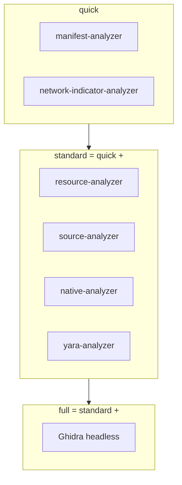

# Analysis pipeline

## Stages

```mermaid
flowchart LR
    U[Upload] --> V[Validate archive]
    V --> M[Extract metadata]
    M --> Q[Queue scan]
    Q --> C[Capability discovery]
    C --> A[Run analyzers]
    A --> N[Normalise findings]
    N --> R[Risk summary]
    R --> P[Persist]
    P --> REP[Report on demand]

    style V fill:#fff7ed,stroke:#b45309
    style A fill:#f0fdfa,stroke:#0f766e
    style N fill:#f0fdfa,stroke:#0f766e
```

## 1. Validation

Runs before any parser sees the file. In order: size cap during streaming, ZIP
local header magic, central directory parse, entry count, per-entry name
safety, symlink rejection, compression method allowlist, cumulative
uncompressed size, per-entry compression ratio, then APK shape — an
`AndroidManifest.xml` must exist, code must exist, and the first `classes.dex`
must actually carry DEX magic.

A failure here is a `400`, never a partially ingested APK.

## 2. Metadata extraction

Androguard decodes the binary manifest; DroidScope parses the resulting XML
itself, because the detection rules need attributes androguard does not
surface — in particular the *absence* of `android:exported` and complete
intent-filter data.

Two subtleties that only appear with real APKs, both handled:

- `aapt2` compiles `android:protectionLevel="normal"` to `0x00000000`, so the
  parser decodes numeric protection levels back to names. Without this, a
  signature-protected component looks identical to an unprotected one.
- `android:networkSecurityConfig="@xml/foo"` becomes a numeric resource id, so
  the reference is resolved through the resource table.

The archive listing is always parsed directly, so DEX and native library
inventories are available even when androguard fails.

## 3. Analyzer execution

| Analyzer | Profiles | Requires | Produces |
|---|---|---|---|
| `manifest-analyzer` | all | androguard | Manifest findings, decoded manifest artifact |
| `network-indicator-analyzer` | all | — | Classified indicators |
| `resource-analyzer` | standard, full | apktool, java | Smali and decoded resources |
| `source-analyzer` | standard, full | jadx, java | Source tree, source/secret/Firebase findings |
| `native-analyzer` | standard, full | pyelftools | ELF inspection, optional Ghidra summary |
| `yara-analyzer` | standard, full | yara-python | Content match indicators |

Each runs under `analyzer_timeout_seconds`. A timeout kills the whole process
group, so a hung JVM cannot outlive the scan.

## 4. Normalisation

Analyzers return `RawFinding` objects. Normalisation:

1. drops findings whose rule an operator disabled;
2. applies any severity override;
3. computes a fingerprint that excludes line numbers;
4. deduplicates by fingerprint within the scan;
5. **masks sensitive evidence** — the plaintext never reaches a column unless
   redaction is explicitly disabled;
6. persists findings and evidence.

## 5. Risk summary

See [risk-scoring.md](risk-scoring.md). The important property is that the
summary carries its own coverage: which analyzers completed, which did not, and
why, so the score is read in context.

## Profile composition

Dynamic analysis is deliberately outside this diagram. Selecting the `full`
profile never installs or runs the application.
